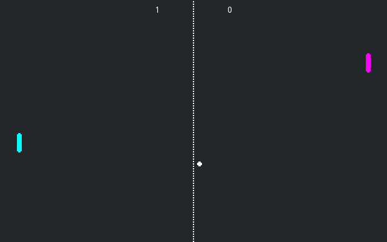

# Pong Multiplayer with Julia

A multiplayer demo of Pong. One player presses "host".
The other presses "join". This only works locally.

Language: Julia ([Godot-julia](../../README.md))

Renderer: Compatibility

> [here](https://github.com/godotengine/godot-demo-projects/tree/master/networking/multiplayer_pong).

Ported to Julia from the C# version in [godot-demo-projects](https://github.com/godotengine/godot-demo-projects/tree/master/mono/multiplayer_pong) (MIT, see [../LICENSE.md](../LICENSE.md)); scenes and assets are unchanged except for script paths and member names.

## Screenshots

