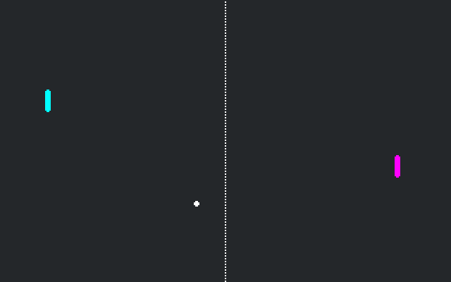

# Pong with Julia

A simple Pong game. This demo shows best practices
for game development in Godot, including
[signals](https://docs.godotengine.org/en/latest/getting_started/step_by_step/signals.html).

Language: Julia ([GodotJL](../../README.md))

Renderer: Compatibility

## How does it work?

The walls, paddle, and ball are all
[`Area2D`](https://docs.godotengine.org/en/latest/classes/class_area2d.html)
nodes. When the ball touches the walls or the paddles,
they emit signals and modify the ball.

Ported to Julia from the C# version in [godot-demo-projects](https://github.com/godotengine/godot-demo-projects/tree/master/mono/pong) (MIT, see [../LICENSE.md](../LICENSE.md)); scenes and assets are unchanged except for script paths and member names.

## Screenshots

