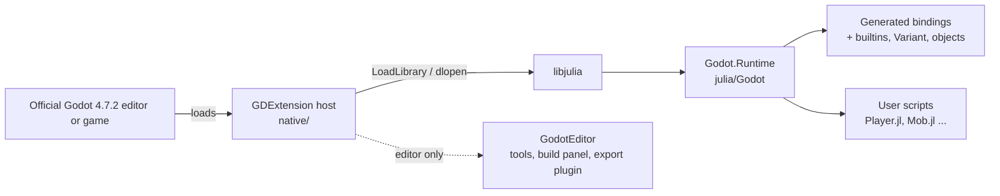
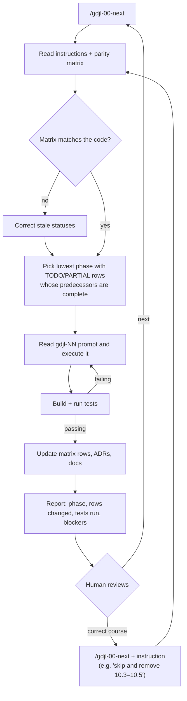
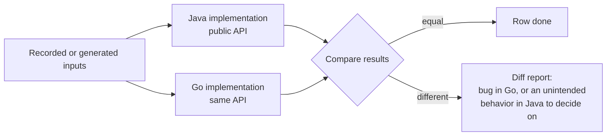

# 2. The Repository and Its Prompt System

Chapter 1 showed you *what* we built. This chapter shows *how we organized the work* so that an AI agent could carry most of it.

We'll walk through the repository the way the agent experiences it at the start of every session:

- which files it reads,
- what each one is for,
- which class of mistake each one prevents.

Then we'll face an uncomfortable question. Copilot did remarkably well here. So why does the same tool, with the same model, struggle so much more on a typical private enterprise codebase?

## Part A — The Repository Through an Agent's Eyes

### The Layout

The repository is small in hand-written code and large in generated code. Counting non-blank lines:

- **About 1,900 lines of C++** in the native host, [`native/src/`](../../native/src).
- **About 11,900 lines of hand-written Julia** across the package sources in [`julia/`](../../julia), plus about 1,600 lines of Julia unit tests.
- **About 257,000 lines of generated Julia bindings.** These aren't checked in. They're regenerated on demand.

Add the integration tests, demos and GDScript helpers, and the hand-written total comes to about 19,000 lines.

| Folder | Role | Analog in Godot's C# support |
|--------|------|------------------------------|
| [`native/`](../../native) | Thin C++ GDExtension host: loads libjulia, implements the `ScriptLanguageExtension`/`ScriptExtension` shims, resource loader/saver, editor plugin shims | `modules/mono` C++ (but as an extension, not an engine module) |
| [`julia/Godot/`](../../julia/Godot) | The Julia package your scripts use directly: generated bindings plus hand-written builtins, Variant, object model, macros, signals, async, and the internal `Godot.Runtime` bridge | `GodotSharp` |
| [`julia/GodotEditor/`](../../julia/GodotEditor) | Editor-only API and tools, loaded only in the editor ([ADR 0004](../adr/0004-editor-api-package.md)) | `GodotSharpEditor`, `GodotTools` |
| [`julia/GodotBindgen/`](../../julia/GodotBindgen) | Generator that reads Godot's `extension_api.json` | `bindings_generator.cpp` |
| [`julia/GodotTestRunner/`](../../julia/GodotTestRunner) | In-engine test runner that reports machine-readable results | — |
| [`addons/godot_julia/`](../../addons/godot_julia) | The distributable addon: `.gdextension` file, binaries, icons, script templates | The .NET editor's bundled assemblies |
| [`tests/`](../../tests) | Headless integration projects, golden math tests, export tests, benchmarks | Godot's .NET CI |
| [`demos/`](../../demos) | Julia ports of the official C# demos | `godot-demo-projects/mono` |
| [`docs/`](..) | Parity matrix, ADRs, user guide, this book | godot-docs C# pages |
| [`scripts/`](../../scripts) | Fetch Godot and its API, generate bindings, run all tests, package the addon | — |

Here's how the pieces fit together at runtime:



The split between a thin C++ layer and a thick Julia layer is deliberate. The [project instructions](../../.github/copilot-instructions.md) say so outright: *"thin C++ … Everything that can live in Julia lives in Julia."*

For an agent, this matters a lot:

- Julia code can be tested in a plain Julia process.
- It can be reloaded without rebuilding.
- It can be inspected interactively.

C++, on the other hand, needs a native build, and that took more than two minutes on the first run. Keeping most logic in Julia keeps most of the agent's **feedback loops** short.

### Always-On Context: `copilot-instructions.md`

VS Code automatically includes [`.github/copilot-instructions.md`](../../.github/copilot-instructions.md) in every chat request in this workspace.

Think of it as the onboarding talk a new team member would get. It's 75 lines long, and every section earns its place:

| Section | What it says | The agent mistake it prevents |
|---------|--------------|-------------------------------|
| **Goal** | Make Julia first-class *with feature parity with Godot's C#/.NET support*; the parity specification is the matrix; "every change must move a row … toward `DONE` or explicitly mark it `GAP`." | Drifting into nice-to-have features; work that isn't traceable to a requirement. |
| **Reference implementation** | A table mapping each area to exact paths in `godotengine/godot` (`csharp_script.cpp`, `runtime_interop.cpp`, `SignalAwaiter.cs`, …), plus "fetch files from GitHub at the pinned Godot tag". | Inventing behavior from memory, or from a different Godot version. |
| **Architecture (decided)** | GDExtension, libjulia embedded, one `.jl` file = one `@godot_class`, abstract type hierarchy, naming rules, `real_t` precision. *"Change only via an ADR."* | Re-arguing the architecture in every new session; silently switching designs halfway through. |
| **Conventions** | No exception may unwind through C/C++ frames; C++ never stores a raw `jl_value_t*` without a pin; foreign threads must be adopted; no `@cfunction` closures; never hand-edit generated code; every feature ships with tests. | The classic, catastrophic bugs of mixed-runtime code. They don't show up in a quick test, but they crash in production. |
| **Phase order** | The 18 prompts, in order, and "Use `gdjl-00-next` to resume." | Starting phase 9 before phase 7 exists. |

Two properties make this file work:

- **It states decisions, not preferences.** "Delivery: a GDExtension built on `godot-cpp`" leaves nothing to negotiate.
- **It's short enough to be read every time.** Long instruction files dilute the important sentences, and they cost context on every request.

### The Specification and State Machine: the Parity Matrix

[`docs/csharp-parity-matrix.md`](../csharp-parity-matrix.md) is the single most important file in the repository.

It has 102 rows in 11 sections, from *Runtime, Packaging, Build* to *Documentation & Samples*. Each row names:

- a C# capability,
- its Julia equivalent,
- the phase that owns it,
- a status.

```markdown
| 4.2 | Stable identity: native object ↔ same managed object | Instance bindings guarantee same Julia object | 07 | DONE (Julia-owned binding token; `==` is identity) |
```

The matrix plays four roles at once:

1. **Specification.** Each row is a requirement phrased against a public reference. "Same as C#" is precise, because you can inspect C#.
2. **Backlog.** The phase column assigns ownership. Nothing is orphaned.
3. **Progress tracker.** `TODO` → `PARTIAL` → `DONE`, with a note on exactly what exists.
4. **Acceptance test.** `DONE` requires code **and** a passing test. `GAP`, meaning it can't be matched, requires an ADR with a justification and a workaround.

That last role is what turns the matrix from a to-do list into a **guard against optimism**.

Agents, like people, like to report success. A rule that says `DONE` needs a passing test, and `GAP` needs a written argument, makes success expensive to fake.

Since phase 15, the rule has been mechanical. [`scripts/check_parity_tests.jl`](../../scripts/check_parity_tests.jl) fails if a `DONE` row isn't referenced by a `# parity: x.y` tag in some test.

Today the count is:

- 92 rows `DONE`,
- 5 `PARTIAL`,
- 4 `TODO`,
- 1 `GAP`.

Each `PARTIAL` row explains what's missing, for example *"defined in `ci.yml` but has not run yet."*

### The Phase Prompts

The 18 files in [`.github/prompts/`](../../.github/prompts) are the work plan.

All of them except the driver share one anatomy. You can see it in the opening lines of the first one, [`gdjl-01-scaffold`](../../.github/prompts/gdjl-01-scaffold.prompt.md):

```markdown
---
name: gdjl-01-scaffold
description: "Phase 1: scaffold the Godot+Julia repository (GDExtension host, Julia packages, addon layout, build system)."
argument-hint: "Optional: Godot 4.x tag to pin, e.g. 4.5-stable"
agent: agent
---
Scaffold the Godot-julia repository as described in the [project instructions](../copilot-instructions.md). Godot tag to pin: `${input:godotTag:latest stable 4.x tag}`.
```

Here are the elements, in order:

- **Frontmatter.**
  - `name` becomes the slash command (`/gdjl-01-scaffold`).
  - `description` tells you what it does.
  - `argument-hint` and `${input:…}` turn the prompt into a parameterized command.
  - `agent: agent` runs it with the built-in Agent rather than Ask or Plan, so it can edit files and run commands.
- **A link back to the instructions.** The prompt doesn't repeat the conventions. It points to them.
- **A behavioral reference.** For example, *"Behavioral reference: `modules/mono/mono_gd/gd_mono.cpp` …"*. This tells the agent where the truth lives.
- **Numbered requirements.** Concrete, checkable, often with exact names.
- **Tests and "Done when".** Executable criteria, such as *"`godot --headless --path tests/integration/smoke --quit` prints the init message without errors."*
- **Owned parity rows.** *"Update parity rows 1.2 and 1.3."*

The phases are ordered by **dependency**:

- runtime before FFI,
- FFI before bindings,
- bindings before the object model,
- the object model before scripts,
- scripts before authoring macros,
- and so on.

The driver prompt, [`gdjl-00-next`](../../.github/prompts/gdjl-00-next.prompt.md), is only five steps long:

- read the instructions and the matrix,
- verify the matrix against the code,
- pick the lowest phase that still owns unfinished rows,
- execute that phase's prompt,
- report.

Chapter 3 is entirely about it. Here's the loop it creates:



### Decision Memory: ADRs

Every new chat starts with an empty context.

Without a record of past decisions, an agent will reasonably re-derive them. Sometimes it reaches a different conclusion. The fifteen **architecture decision records** in [`docs/adr/`](../adr) prevent that.

They also capture something prompts can't: **deviations from the prompt, with reasons**. Here are two examples.

- **[ADR 0002](../adr/0002-runtime-loading.md): load libjulia at runtime instead of linking it.**
  - The project instructions say libjulia is "embedded via the Julia C embedding API".
  - The agent found that linking would cause three problems. It would tie the extension to one Julia build. It would cause MSVC/MinGW import-library problems on Windows (official Julia binaries are built with MinGW, Godot usually with MSVC). And it would make the editor unusable when Julia is missing.
  - So it loads the library dynamically and resolves a small table of exported symbols.
  - The ADR also records an empirical detail no model would know from training. In Julia 1.13, the exported `jl_gc_{safe,unsafe}_{enter,leave}` take no `ptls` argument, although the header macros with the same names do.
- **[ADR 0003](../adr/0003-generated-api-shape.md): the shape of the generated API.**
  - The phase 4 prompt suggested C#-like `Input.is_action_pressed("jump")`.
  - The ADR explains why that spelling was rejected: overloading `getproperty` on types would invalidate a large amount of compiled Base Julia code.
  - It chose `is_action_pressed(Input, "jump")` instead, and states the consequence honestly: *"The C# parity row for singleton/static call syntax is met in capability, not in spelling."*

Both ADRs show the agent pushing back on its own instructions. It does so with evidence, and in a durable form that later sessions will respect.

You want that behavior. The ADR convention is what makes it safe.

### Learned Memory: Notes the Agent Keeps for Itself

Instructions encode **intent**. But some knowledge is **experience**: facts discovered by failing.

In VS Code, the agent can keep repository-scoped memory notes that persist across chats. For this project, VS Code keeps them for this workspace, and they aren't among the published files.

A few verbatim entries give you the flavor:

> Never call jl_atexit_hook: it suspends adopted engine threads -> hang when Godot joins them.

> Never run integration tests while a previous (timed-out) run is alive: Godot keeps the addon DLL locked → ENOTEMPTY in prepare_test_projects.

> Some files (e.g. native/src/register_types.cpp) ended up CRLF; replace_string_in_file reported success but didn't apply — rewrite file if edits don't stick.

Look at the third note. It's about the agent's *own tooling*, not the product.

That's the point of memory. It saves the next session from spending an hour rediscovering something the previous session already paid for.

Keep this distinction in your own projects:

- Put **intent** in instructions, prompts and ADRs. These are reviewed and versioned.
- Put **experience** in memory. It's cheap, terse, and pruned when it goes stale.

### Executable Oracles

An agent is only as reliable as the feedback it can get without asking you.

This repository provides several layers of that feedback. Each one is an **oracle** the agent can run by itself:

- **Julia unit tests** per package (`julia/*/test/`).
- **Headless integration projects** under [`tests/integration/`](../../tests/integration). These are eleven Godot projects run by `tests/integration/run.jl`. They emit a machine-readable `GDJL_TEST_RESULT {json}` line, check expected output and errors, and run leak checks.
- **Golden math tests** whose expected values are computed **by Godot itself** from GDScript expressions ([`scripts/make_math_golden.jl`](../../scripts/make_math_golden.jl)). The agent can't grade its own homework.
- **Doc tests** that execute every Julia block in our user guide ([`scripts/doctest_docs.jl`](../../scripts/doctest_docs.jl)).
- **Demo runs**, **export tests**, **benchmarks** against stored baselines, and the **parity-tag check**.
- **One entry point for all of it:** `julia scripts/test_all.jl`.

The key design choice is that Godot runs **headless**. The engine, the editor (`--editor --headless`) and exported games all start without a window. So every layer runs in a terminal on a laptop, in minutes.

Remember this point. It's central to Part B.

### The Tooling Around It (as of VS Code 1.145, November 2026)

A few facts about the current Copilot tooling matter when you use this repository's prompts. We checked them against the VS Code documentation at the time of writing.

- **Built-in agents.** The agent picker offers three:
  - **Agent** implements and validates changes.
  - **Ask** does read-only research. It can't edit files or run state-changing commands.
  - **Plan** researches a task and produces an implementation plan for you to review.

  Custom agents appear in the same picker. Use Ask and Plan for the exercises in this book that say "explain" or "design". Use Agent for the phase prompts.
- **Harnesses.** A **harness** coordinates the model, context and tools.
  - The default for new sessions is the **Copilot** harness. It's built on the Copilot SDK and shared with other Copilot clients.
  - The older **Local** harness is VS Code's original, editor-specific one.

  Changing the model or the agent doesn't change the harness.
- **Prompt files run only in the Local harness.** The `*.prompt.md` files in this repository run as slash commands in **Local** sessions. That includes the `gdjl-*` phases and the `book-*` prompts that generated this book.
  - The Copilot harness uses **agent skills** instead.
  - VS Code can convert prompt files to skills (*Chat: Open Customizations → Migrations*). The conversion doesn't keep the `agent`, `model` or `tools` frontmatter, though.
  - If `/gdjl-00-next` doesn't appear, check the Session Target first.
- **Models.** The book is written around Claude Opus 5.5. The model picker offers other frontier models, and nothing in the prompts depends on a specific one. What they do depend on is a model that reads carefully, follows long instructions, and runs tools in a loop.
- **Subagents and memory.** The agent can delegate self-contained research to subagents, which keeps its own context focused. It can also keep the memory notes described above.

These details will change. The repository's prompts are plain Markdown, and they'll outlive any particular UI.

## Part B — Why Copilot Works So Much Better with Godot 4.7.x Than with a Private Enterprise Portfolio

Our daily work includes a very different codebase: a private enterprise portfolio.

Its details are confidential, and nothing in this book identifies it. To ground the comparison in facts rather than impressions, we analyzed it read-only and kept only aggregated, anonymized observations:

- It consists of **several dozen repositories** with **thousands of source files**. It's mostly long-lived enterprise Java with server-rendered web pages, XML-based configuration and SQL scripts.
- In most repositories, the recorded history begins **about a decade ago**. Nearly all of them are **still changing this year**.
- Almost every build **inherits from shared parent build definitions**. **About two-thirds expect APIs supplied by an application container at runtime.**
- There are **more than a hundred environment-specific configuration files**, one variant per deployment environment.
- About **one source file in eight is a test**. **Roughly half of the repositories have no automated tests at all.** Libraries for local fakes (in-memory databases, mocks, test containers) appear in only a small minority of build files.
- Most repositories **have CI pipelines**, but those run on shared infrastructure.
- The top-level READMEs are **mostly short stubs**. Only a handful exceed a kilobyte, though some repositories carry substantial documentation deeper in their trees.
- **No repository contains an agent instructions file.**

None of this is unusual. It describes a large share of the business-critical software in the world. And it's perfectly serviceable for the people who know it.

The question is what an agent sees when it opens it. Here are the factors that, in our experience, make the difference.

### 1. Public Knowledge and Training Data

Godot, godot-cpp, GDScript, Godot's C# bindings, Julia and their documentation are all:

- public,
- permissively licensed (MIT for Godot),
- widely discussed.

Before reading a single file, the model already has a strong prior. It knows what `ScriptLanguageExtension` is, how Godot's C# instance bindings work, and what idiomatic Julia looks like.

The private portfolio's in-house frameworks, shared parent builds and business rules are, by definition, absent from any training data. Every convention has to be rediscovered from the code, every time.

### 2. Fetchable Ground Truth at a Pinned Version

[`GODOT_VERSION`](../../GODOT_VERSION) pins 4.7.2-stable. The instructions say to fetch reference files *at that tag*.

Recency is the subtle part. Godot 4.7 may be newer than what the model saw in training, so the model's memory of Godot is partly stale. The pin turns that weakness into a non-issue, because the agent can read the truth.

Here's an example from [`scripts/fetch_api.jl`](../../scripts/fetch_api.jl):

- The phase 1 prompt asked for `--dump-gdextension-interface`, but recent Godot versions use `--dump-gdextension-interface-json`.
- The script uses the current flag.
- It also documents a 4.7 quirk: `--dump-extension-api-with-docs` exits with an error once extensions are loaded.

Wrong knowledge was corrected by reading the source, not by guessing better.

A private codebase has no external ground truth. If the code and the people disagree, the agent can't look it up.

### 3. A Reference Implementation as the Specification

"Match C#" turns open-ended design into **port and verify**.

- When the agent needs to know what `refcount_decremented` should do, the answer is in `csharp_script.cpp`.
- When it needs the list of export hints, the C# source generators enumerate them.
- Most phase prompts in this repository name the exact C# file to study.

Enterprise requirements more often live in people's heads, in tickets, and in documents outside the repositories. The executable specification is the running system itself, in an environment the agent can't reach.

### 4. Machine-Readable Interfaces

Godot publishes `extension_api.json` (every class, method, property, enum and signal, with docs) and `gdextension_interface.json`.

Those two files made it possible to *generate* 1036 classes and about 17,000 methods instead of writing them. They also make it possible to regenerate everything when the version changes.

Generation is where agents are at their most reliable:

- write a generator once,
- test it on a fixture,
- run it on everything.

The comparison portfolio's interfaces are spread across code, XML configuration, environment-specific property files and database scripts. There's no single machine-readable description to generate from or check against.

### 5. A Local, Fast, Deterministic Feedback Loop

This is the biggest factor.

Every test in this repository runs on one machine, with one command. No network service, no database server, no credential. Headless Godot makes even the editor testable.

An agent that can run `julia tests/integration/run.jl objects` and get a JSON verdict a few minutes later can iterate dozens of times per phase.

The comparison portfolio is different:

- builds resolve shared parent definitions and container-provided APIs,
- deployments need environment-specific configuration,
- many behaviors only appear against external infrastructure the agent can't reach,
- half the repositories have no tests to run, even locally.

So the agent has to *reason* about whether a change is correct, where in this repository it would simply *check*. Reasoning is far less reliable than checking.

### 6. One Coherent Repository with a Measurable Goal

Godot-julia is one repository with one goal, and progress is a number: 92 of 102 rows `DONE`. The agent always knows what "next" means and when it's finished.

A portfolio of several dozen repositories has no such single frame. Its repositories are coupled implicitly, through shared parents, shared databases and shared configuration. A change in one repository may need changes in others that the agent can't see from its workspace.

### 7. Freedom to Share

Public code can be:

- pasted into a web search,
- compared with upstream,
- quoted in an issue,
- fetched by the agent from GitHub.

Confidential code restricts which tools and services the agent may use, and what context may leave the machine.

This chapter itself was written under such rules. The analysis used read-only tools, kept only aggregates, and was checked to make sure no name escaped into the text.

### 8. Recency and Consistency of Conventions

This repository was written in one style, by one process, in a few days. Its naming rules are written down ([ADR 0003](../adr/0003-generated-api-shape.md)).

A decade-old portfolio carries several generations of conventions, frameworks and build practices. The agent can't tell which ones are current, and it will happily imitate the wrong one.

### What You Can Do About It

None of these factors is destiny. Each artifact that made Godot-julia agent-friendly has an equivalent you can add to a private codebase:

| Recommendation | Godot-julia artifact that demonstrates it |
|----------------|-------------------------------------------|
| **Add an instructions file** with goal, architecture decisions, conventions and the reference material to consult. Keep it short and decisive. | [`.github/copilot-instructions.md`](../../.github/copilot-instructions.md) |
| **Write the specification down** as a table with owners and a strict definition of done. Where there is no external reference, use the current system's observable behavior as the reference and describe it row by row. | [Parity matrix](../csharp-parity-matrix.md) |
| **Record decisions as ADRs**, especially deviations and "we tried X, it failed because Y". | [`docs/adr/`](../adr) |
| **Make builds and tests reproducible locally**: containers or emulators for databases and application containers, fakes for external services, checked-in configuration for a local profile. This single investment pays for itself many times over. | Headless Godot, [`scripts/fetch_godot.jl`](../../scripts/fetch_godot.jl), [`scripts/test_all.jl`](../../scripts/test_all.jl) |
| **Add characterization tests before changing untested code**. Let the agent write them against current behavior first; they become its oracle. | Golden tests generated by the reference itself ([`scripts/make_math_golden.jl`](../../scripts/make_math_golden.jl)) |
| **Consolidate context**: open related repositories in one multi-root workspace, or add a short map of how they couple. | One repository, one [README](../../README.md) |
| **Connect internal documentation through approved channels**, for example an MCP server for the internal wiki or ticket system, so the agent can look things up without anyone pasting confidential text around. | Fetchable upstream sources at a pinned tag |
| **Split work into a resumable prompt sequence** with a driver that reads state from the repository. | [`gdjl-00-next`](../../.github/prompts/gdjl-00-next.prompt.md) and the phase prompts |

Start with the two cheapest items: **the instructions file** and **one locally runnable test command**.

Our opinion, based on this project, is that they'll matter more to the agent's results than which frontier model you pick.

### A Case in Point: Preparing a Portfolio for Reimplementation

The comparison portfolio is about to face exactly the kind of task this book describes.

It has been decided to reimplement part of its functionality in Go, with the current Java implementation as the effective source of truth. The system is **safety-critical**.

That makes it a port with a reference implementation. It's the same shape as Godot-julia's port of C# to Julia, except that here the reference is the portfolio itself.

Whether an agent can do that port well depends less on the agent than on the reference. Godot's C# support was a good reference:

- one module,
- a published machine-readable API,
- documented behavior,
- tests.

To see how the portfolio compares, we analyzed its declared dependencies between repositories. Again, we kept only aggregates:

- The dependency list covers **close to sixty repositories** with **about 140 dependencies between them**. Roughly 25 repositories depend on no other repository in the portfolio.
- **Thirteen repositories form a single cycle.** Each of them depends, directly or through the others, on every other one. Thirteen pairs depend on each other directly, in both directions.
- **30 of the 32 repositories that have internal dependencies are either part of that cycle or depend on it.** The other two are small foundation libraries that sit cleanly below it.
- The two most-used libraries inside the cycle are **each used by about twenty other repositories**.
- Today the cycles are resolved by building against **several versions of the generated build artifacts**. A repository compiles against an older, already-published artifact of a dependency that itself depends on the repository being built.

That last point deserves a moment.

When the agent reads repository A, it sees the current source of its dependency B. But at build time and at runtime, A may use an older published version of B, built against an even older version of A.

There's no single version of the truth to read, and nothing in the source says which version applies. That's a recipe for confident, plausible and wrong answers.

#### Eight Improvements, and Why Each Helps the Agent

The plan is to improve the Java codebase *before* porting it. Each improvement has a direct counterpart in what made Godot-julia work:

1. **Remove the cyclic dependencies between repositories.** A cycle has no bottom, so there's no order in which to understand it, test it or port it.
   - Go makes this concrete. The Go toolchain rejects import cycles, so a cyclic module graph can't be ported as it stands. It has to be untangled at some point anyway.
   - Doing it in Java, where the existing behavior can be tested, is far safer than doing it during the port.
   - An acyclic graph also gives the agent a natural work order: leaves first. That's the role the phase order plays in this book ([chapter 3](03-the-resume-loop.md)).
   - And it removes the multi-version build artifacts, so the source the agent reads is the code that runs.
2. **Minimize external dependencies.** Every library is behavior the agent has to know: its version, its quirks, its defaults. Each one also needs a Go equivalent with the same semantics, which is a translation problem of its own. Fewer dependencies means a smaller specification to reproduce and fewer places for the agent to guess.
3. **Make coding practices and naming conventions consistent across all repositories.** Agents learn by imitation. If three repositories validate input three different ways, the agent picks one, often the oldest. Consistent conventions also make the Java-to-Go mapping mechanical. That's how written naming rules ([ADR 0003](../adr/0003-generated-api-shape.md)) let `scripts/api_diff.jl` check every C# member against its Julia name ([chapter 20](20-parity-audit.md)).
4. **Never use an external library for functionality the Java standard library provides.** The JDK is among the most documented and most discussed code in existence, so the model knows its semantics precisely.
   - Go's standard library covers the same ground (time, cryptography, encodings, HTTP), so standard-library code maps to standard-library code.
   - A small third-party helper for the same task is a semantic unknown in both directions.
   - In a safety-critical system, it's also one more dependency to audit and patch.
5. **Clearly document the API each repository intends for external consumption.** The public API is the boundary the Go implementation must reproduce. Everything behind it is free to change.
   - Without that boundary, the agent has to treat every public class and method as contract.
   - It ports internals that were never meant to be stable, and it can't tell an accident from a promise.
   - In Godot-julia, that boundary was `extension_api.json` and the parity matrix: a complete, explicit list of what had to match.
6. **Verify that other repositories only use that intended API.** A documented boundary that isn't enforced decays. Check it automatically, with Java modules (`module-info.java` exports, available once the code is on a modern JDK) or architecture tests. That's the same move as turning "no `DONE` without a test" into a failing script ([chapter 18](18-testing-ci.md)). It also tells the agent, reliably, which uses it must preserve when it ports a repository.
7. **Add unit tests for every public API, simulating dependencies with mocks.** These tests become the executable specification.
   - Mocking the dependencies makes them run locally and fast, which is factor 5 above.
   - It also lets each repository be verified on its own, in dependency order.
   - The same test cases, with the same inputs and expected outputs, can then be run against the Go implementation. That's how Godot itself served as the oracle for the Julia math types ([chapter 8](08-builtin-math.md)).
8. **Update the code from JDK 6/8 to JDK 25.** Most of the Java that models have learned from is modern Java, so modern idioms are understood best.
   - Records, sealed interfaces and pattern matching state intent explicitly. They map naturally to Go's structs, interfaces and type switches.
   - The modern standard library (`java.time`, the built-in HTTP client) replaces many external libraries, which helps items 2 and 4.
   - The module system makes item 6 enforceable by the compiler.
   - And the code ends up on a supported, patched platform, which a safety-critical system needs regardless.

Taken together, these changes make the Java code a precise specification. They also make it **checkable**, which is what an agent needs most.

#### Side by Side: Java and Go Running the Same Inputs

The same improvements make it possible to run both implementations side by side and compare their results.

With acyclic modules, a documented public API and tests that mock dependencies, you can put each Go component behind the same interface as its Java counterpart and feed both the same inputs:



This is **differential testing**. For a safety-critical system, it's the strongest evidence available that the new implementation behaves like the old one.

It's also a parity matrix in all but name: one row per public API, `DONE` when Go matches Java on the agreed cases. Godot-julia's golden tests worked the same way. Compute the expected values with the reference, then check the port against them ([chapter 8](08-builtin-math.md)).

Without the improvements above, you have:

- no stable API to put both implementations behind,
- no isolated components to compare,
- no way to tell which version of the Java code is the reference.

#### Good Code Is a Specification

The point of this section is simple. Improving the existing code makes the agent better at the port, even though the target language is different.

Good code is a detailed specification, and usually a far less ambiguous one than natural language.

Take a requirement such as "validate the request and reject expired credentials". It leaves dozens of questions open. A method with precise types, a documented contract and tests that pin down the edge cases answers them:

- which clock,
- which time zone,
- what happens at the exact expiry instant,
- which error is returned,
- what is logged.

An agent translating that code to Go doesn't have to guess. It has to translate. And translation against tests is the kind of work agents do most reliably.

That's what this project demonstrates. Godot-julia is what GitHub Copilot produced when it worked against an existing, high-quality codebase: Godot's C# support, with a clear module boundary, a published API, documentation and tests.

The target language was different from the reference, just as Go differs from Java. It didn't matter much, because the reference was precise.

The investment that makes a Java-to-Go port go well is the same one that made a C#-to-Julia port go well: **make the reference worth reading**.

## Techniques to Reuse

- **Decisions, not preferences.** Write architecture as settled facts and route changes through ADRs. New sessions then build on old ones instead of re-arguing them.
- **A matrix as spec, backlog and acceptance test.** One table with owners, and a definition of done that requires a passing test.
- **Behavioral references.** Point every requirement at the code or document that defines the truth, at a pinned version.
- **Keep the slow layer thin.** Put logic where the feedback loop is fastest. Keep compiled glue minimal.
- **Separate intent from experience.** Instructions and ADRs for what you want; memory notes for what you learned the hard way.
- **Make the oracle local.** If the agent can't run it on one machine with one command, it isn't an oracle for the agent.

## Try It Yourself

1. Open the repository in VS Code and select the **Ask** agent. Ask: *"Using only the project instructions and the parity matrix, explain which phase owns object identity, and which test proves it."* Compare the answer with rows 4.2–4.3 and `tests/integration/objects/`.
2. Switch to **Plan** and ask: *"Draft a `copilot-instructions.md` for a codebase I describe"*. Then describe a project of your own in three sentences. Check the draft against the five-section table above.
3. Pick one repository you work on. Write down, honestly, how many of the eight factors in Part B apply to it. Choose the one recommendation from the table that would help most, and do it this week.

---
[← Previous: Why AI Coding Deserves Your Attention](01-why-ai-coding.md) · [Contents](README.md) · [Next: The Resume Loop →](03-the-resume-loop.md)
