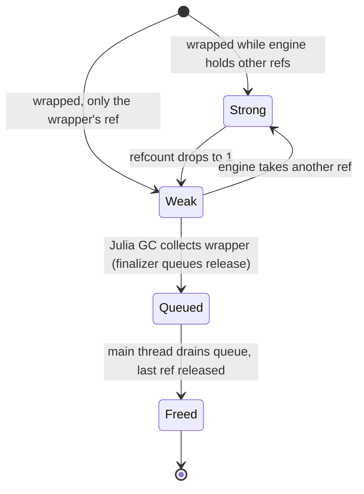

# 10. The Object Model: Two Garbage Collectors, One Object

Every Godot game is a graph of engine objects: nodes in a scene tree, resources, servers, singletons.

When Julia code touches one of them, you hit a question with no obvious answer: *what is the Julia value that stands for this object?* Then comes a harder one: *who decides when it dies?*

Godot manages object lifetimes in two ways:

- **Manually freed objects.** Most objects (nodes, for example) live until someone calls `free()` or `queue_free()`.
- **`RefCounted` objects.** Resources and many helpers are freed automatically when their reference count drops to zero.

Julia manages *its* objects with a **tracing garbage collector**. It runs whenever it likes, on whatever thread it likes.

Phase 7 makes these two systems agree:

- there is exactly one Julia wrapper per engine object, so `get_node(root, "A") === get_node(root, "A")`;
- an engine object stays alive exactly as long as someone, in either world, needs it;
- a Julia wrapper never outlives its object without knowing it;
- and none of this may deadlock, crash or leak when several threads are involved.

This is the hardest subsystem in the project. Its prompt is also the most prescriptive one.

It doesn't invite the agent to design anything. It tells the agent to copy a design that already works.

The phase needs the generated classes (chapter 7) and Variant conversions (chapter 9). Scripts (chapter 11) build directly on it: a Julia script struct *becomes* the wrapper of its engine object.

## The Prompt

[`.github/prompts/gdjl-07-object-model.prompt.md`](../../.github/prompts/gdjl-07-object-model.prompt.md):

```markdown
---
name: gdjl-07-object-model
description: "Phase 7: Julia object model for Godot objects — wrappers, identity, RefCounted/GC integration, free/dispose, casting, weak refs, cross-language calls."
agent: agent
---
Implement the object model in `julia/Godot/src/object/`. Follow the [project instructions](../copilot-instructions.md). Behavioral references: `GodotSharp/Core/GodotObject.base.cs`, `DisposablesTracker.cs`, `Bridge/ScriptManagerBridge.cs`, `NativeInterop/InteropUtils.cs`, and in C++ `csharp_script.cpp` (`CSharpLanguage::get_instance_binding`, `_instance_binding_*_callback`, `CSharpInstance` refcount handling `refcount_incremented`/`refcount_decremented`, strong/weak GCHandle switching).

## Requirements

1. **Handle**: every wrapper (native or user script) stores the native `GDExtensionObjectPtr` and an "alive" flag. `godot_ptr(obj)` accessor used by bindings.
2. **Identity**: one Julia object per native object, via `object_get_instance_binding` / `object_set_instance_binding` with `GDExtensionInstanceBindingCallbacks`. When the native object has a Julia script, the binding returns the user's script struct (C# parity: engine-returned objects are the script instance). Unknown concrete class → most-derived generated wrapper via `object_get_class_name` lookup (cached).
3. **Lifetime** (mirror C# exactly):
   - Non-`RefCounted` objects: Julia wrapper is held *weakly*; native object lives until `free()`/`queue_free()`. After free, wrapper is marked dead; any call raises `ObjectDisposedError`-like exception; `is_instance_valid(obj)` returns `false`.
   - `RefCounted`: Julia holds one reference. Switch the pin between strong and weak when refcount crosses 1 (C#'s strong/weak GCHandle trick) so cycles through the engine are collectable. Finalizer releases the reference on the main thread (queue it; never call into Godot from a finalizer on a GC thread).
   - `Base.finalize(obj)` / `close(obj)` as `Dispose` equivalent.
4. **Construction**: `Node()` (native) and user script construction from Julia (`Player()` creates native base object, attaches the script, runs Julia field initializers) and from the engine (`ClassDB.instantiate`, scene instancing) — both paths produce identical state.
5. **Casting**: `obj isa Node2D`, `convert(Node2D, obj)` (throws on mismatch), `tryconvert`-style `as(Node2D, obj)` returning `nothing`; `get_node(T, self, path)` and `get_node_or_null(T, ...)` matching C# `GetNode<T>`.
6. **Weak refs**: `weakref(obj)` returning Godot `WeakRef` (C# `GodotObject.WeakRef`).
7. **Cross-language dynamic access**: `call(obj, :method, args...)`, `get(obj, :prop)`, `set!(obj, :prop, v)`, `has_method`, plus `getproperty` fallback to dynamic `get` for properties defined by GDScript scripts. Returns `Variant`-converted Julia values.
8. **Threads**: document which operations are thread-safe, mirroring Godot's thread-safety guidelines; assert main thread in debug builds where Godot requires it.

## Tests

- Identity: `get_node("A") === get_node("A")`; script instance returned from `get_parent()`.
- Freed-object access raises and does not crash.
- RefCounted cycle Julia→Resource→Julia closure is collected.
- No leaked objects at exit (`--verbose` leak report empty) in integration tests.

Update parity rows 4.1–4.8, 4.10.
```

## Anatomy of the Prompt

### "Mirror C# Exactly"

Most prompts in this project describe *what* to build and leave the *how* to the agent. Requirement 3 is different.

Its heading says *"mirror C# exactly"*. The behavioral reference names individual C++ functions:

- `CSharpLanguage::get_instance_binding`,
- the `_instance_binding_*_callback` family,
- `refcount_incremented`/`refcount_decremented`.

It also names a specific technique: *"strong/weak GCHandle switching"*.

So when should you give an agent freedom, and when should you demand a **faithful port**? Here, the answer depends on two things:

- **How subtle the failure modes are.** Lifetime bugs between two memory managers don't fail tests reliably. They leak slowly, crash under load, or deadlock one run in a thousand. A plausible-looking design invented from scratch could pass every test the agent thinks to write.
- **Whether a battle-tested solution exists.** Godot's C# module has solved exactly this problem for years, for millions of users. Its design has already met the edge cases.

When both are true, prescribe the design and point at the code. Save the agent's creativity for the parts that have no precedent.

### The Strong/Weak Trick, Explained in One Clause

> Switch the pin between strong and weak when refcount crosses 1 (C#'s strong/weak GCHandle trick) so cycles through the engine are collectable.

This clause holds the whole idea, so let's unpack it.

A Julia wrapper of a `RefCounted` object owns one engine reference. Now suppose the wrapper also stores Julia state, such as a closure, and the engine object holds a reference back to that state.

If the binding always kept the wrapper alive, the two would keep each other alive forever. That's a **cycle that crosses the language boundary**, and neither garbage collector can see it in full.

C#'s trick is to look at the reference count:

- While the engine holds references *besides* the wrapper's own (`refcount > 1`), the binding keeps the wrapper **strongly**. The engine might hand the object back to Julia at any time, so its Julia state must survive.
- When only the wrapper's reference is left (`refcount == 1`), the binding holds it **weakly**. Julia's garbage collector is free to collect it.
- The collected wrapper then releases the last reference, and the engine object is freed.

Notice that the prompt didn't just say "port the trick". It said *why*: "so cycles through the engine are collectable".

Then it turned that why into a test: *"RefCounted cycle Julia→Resource→Julia closure is collected."*

### A Rule About Finalizers

> Finalizer releases the reference on the main thread (queue it; never call into Godot from a finalizer on a GC thread).

Julia **finalizers** run when the garbage collector decides, on whatever thread is collecting.

Calling into Godot from there would break Godot's threading rules. Worse, it could re-enter Julia from inside the collector.

The rule in parentheses prescribes the standard solution: finalizers only *queue* work, and the queue is drained at **safe points** on the main thread.

As with the GC rule in chapter 5, the prompt states the invariant and the mechanism together.

### Identity with a C# Parity Twist

Requirement 2 asks for one Julia object per native object. It then adds a twist: when the native object has a Julia script, the binding must return your script struct.

In C#, when a node has a C# script, `GetParent()` returns an instance of your class, not a generic `Node`.

This sentence connects phase 7 to phase 8. The script struct must be able to *become* the wrapper, so every engine call that returns the object returns your struct.

### Threading as a Deliverable

Requirement 8 asks for documentation: *"document which operations are thread-safe, mirroring Godot's thread-safety guidelines."*

Writing the rules down forces the agent to decide them. That's the point.

Thread safety you haven't written down is thread safety you haven't designed.

### Tests Aimed at the Scary Cases

The four tests don't check that "the object model works". They target the four ways object models fail:

1. **identity**: two lookups give two different wrappers;
2. **use after free**: a call on a freed object crashes instead of raising an error;
3. **cycles**: a cross-language cycle leaks;
4. **leaks at exit**: anything left over when the engine shuts down.

Each one is concrete enough to write directly.

## What the Agent Built

[ADR 0007](../adr/0007-object-model.md) records the decisions. [`julia/Godot/src/object/lifetime.jl`](../../julia/Godot/src/object/lifetime.jl) holds the core.

Its header comment summarizes the design in a dozen lines, including where it was ported from:

```julia
# Object identity and lifetime through GDExtension instance bindings.
# Ported from Godot's modules/mono/csharp_script.cpp (`_instance_binding_*_callback`, strong/weak GCHandle switching)
# and GodotSharp/Core/GodotObject.base.cs, DisposablesTracker.cs (MIT, Godot contributors).
```

### One Binding per Object

Godot lets an extension attach an **instance binding** to any object. It's an opaque pointer that the extension creates the first time it asks for it. Godot gives it back on every later request.

Julia's binding is a small mutable struct:

```julia
mutable struct InstanceBinding
    const ptr::Ptr{Cvoid}
    @atomic strong::Any       # the wrapper while it must stay alive, else `nothing`
    @atomic weak::Base.WeakRef
    @atomic holds_ref::Bool   # the current wrapper owns a RefCounted reference
end
```

The binding holds the wrapper in two slots, one weak and one strong. Switching between "kept alive" and "collectable" is therefore a single atomic store.

The pointer Godot stores is the address of this struct, rooted in a dictionary until Godot frees the object. So looking up a binding is a pointer conversion, with no dictionary search on the hot path.

### The Strong/Weak Switch

The `reference` callback is where C#'s trick lives. Godot calls it whenever a `RefCounted` object's count changes:

```julia
        rc = Internals.reference_count(b.ptr)
        if reference != 0
            # The engine references the object again: keep the Julia wrapper (and its state) alive.
            if rc > 1 && (@atomic b.holds_ref)
                w = _wrapper(b)
                w === nothing || (@atomic b.strong = w)
            end
            return 0x00
        end
        # Only the wrapper's reference is left: let Julia's GC decide.
        rc == 1 && (@atomic b.holds_ref) && (@atomic b.strong = nothing)
        return UInt8(rc == 0)
```

The two comments state the policy more clearly than any diagram. Here's one anyway, for a `RefCounted` object with a Julia wrapper:



### Finalizers That Only Queue

The finalizer of a `RefCounted` wrapper does only two things:

- clear the wrapper's pointer,
- push a release onto a queue, protected by a spin lock ([`core/Internals.jl`](../../julia/Godot/src/core/Internals.jl)).

```julia
function finalize_object(o)
    p = getfield(o, :__ptr)
    p == C_NULL && return nothing
    setfield!(o, :__ptr, C_NULL)
    enqueue_release!(PendingUnref(p))
    return nothing
end
```

`flush_releases!()` drains the queue. Its docstring carries the rule: *"Call only from safe points."*

In phase 7, the safe points were the runtime's entry points. Phase 10 added a per-frame flush from the main-thread scheduler.

### Dead Wrappers Raise, They Don't Crash

Godot can free an object by many routes:

- `free`,
- `queue_free`,
- the engine freeing a parent's children,
- GDScript.

Whatever the route, Godot calls the binding's free callback, which clears the wrapper's pointer. Every generated method obtains the pointer through `native_ptr`, which checks it:

```julia
@inline function native_ptr(o::GodotObject)
    p = getfield(o, :__ptr)
    p == C_NULL && throw(FreedObjectError(typeof(o)))
    return p
end
```

`FreedObjectError` is Julia's `ObjectDisposedException`. `is_instance_valid(x)` returns `false` for freed wrappers and for `nothing`.

The check costs one comparison per call. In return, it turns the most common class of game-scripting crash into an ordinary, catchable error.

### Construction, Casting and Dynamic Access

The remaining requirements map to small, readable pieces:

- **Construction.** `Node()` calls `construct_object`. It constructs the engine object, wraps it (adopting the first reference for `RefCounted` types), and sends `NOTIFICATION_POSTINITIALIZE`. That last step has a story of its own, told below.
- **Casting.**
  - `obj isa Node2D` is C#'s `is`.
  - `convert(Node2D, obj)` is a C# cast and throws `TypeError` on mismatch.
  - `as(Node2D, obj)` is C#'s `as` and returns `nothing`.
  - `get_node(Sprite2D, root, "S")` is `GetNode<Sprite2D>("S")`.
- **Dispose.** `finalize(obj)` releases Julia's reference immediately and invalidates the wrapper. The prompt also offered `close(obj)`, but the ADR explains why it was rejected: *"engine classes such as `FileAccess` have their own `close` method."*
- **Dynamic access.** `obj.name` uses a generated property when one exists. Otherwise it falls back to the engine's `get`, so properties defined by GDScript scripts are reachable. `Godot.call`, `set!` and `has_property` are the explicit forms.
- **Script structs.** `bind_wrapper!(p, w)` makes your struct the wrapper of an object. It's the hook phase 8 needed.

### Threading Rules, Written Down

The ADR's *Threading rules* section is short and specific:

> - Julia wrappers can be passed between threads. Engine thread-safety rules apply exactly as in C# …
> - Binding bookkeeping is guarded by a lock, so wrapping, binding and finalizing from several Julia threads is safe.
> - Finalizers can run on any thread, so they never call into Godot: they only queue releases, which run on the main thread at safe points.
> - Calls arriving from Godot threads that Julia doesn't know are adopted (`jl_adopt_thread`, phase 02).

The same rules appear in the README, so you'll find them there too.

## Where Reality Pushed Back

The phase 7 report opened with a section titled *"What was breaking `Node()` in the engine"*. It lists three bugs, and each one is worth studying.

### 1. A Name That Meant Two Things

> **Name clash:** inside the `Godot` module, the generated Godot `WeakRef` class shadows Julia's `Base.WeakRef`. The binding create callback was constructing a Godot `WeakRef`, which created another binding, and so on until the stack overflowed. Fixed by writing `Base.WeakRef` everywhere; no other hand-written code uses a clashing name unqualified.

Chapter 7 described the naming rule that caused this. Classes whose names Base already exports are *defined but not exported*.

That protects you in your scripts. Inside the package, though, the generated name wins.

Here's how the loop formed:

- Creating a binding needed a Julia weak reference.
- `WeakRef()` built a Godot `WeakRef` object instead.
- That object needed a binding, which needed a `WeakRef()`, and so on.

The fix is visible in the struct above (`@atomic weak::Base.WeakRef`). The rule went into the agent's memory notes: *"Always write `Base.WeakRef`, `Base.Timer`, etc. in package code."*

Also notice *"no other hand-written code uses a clashing name unqualified"*. The agent didn't stop at fixing the failing line. It checked the whole code base for the same class of bug.

### 2. A Shared Binding Key

> **Shared binding key:** bindings were keyed by the extension library pointer, which godot-cpp (the C++ host) also uses for its own wrappers. Julia then received bindings it hadn't created (a `KeyError` on the `Engine` singleton). Julia now uses its own key, as C# does.

Godot identifies instance bindings by a **token** pointer. That way, several extensions can each attach their own binding to the same object.

The obvious token is the extension's library pointer. But that's exactly what godot-cpp already uses for *its* wrappers. (godot-cpp is the C++ framework the native host is built on.)

Two owners, one key.

The fix uses a Julia-owned address. The comment explains it for whoever touches the code next:

```julia
# Binding token: godot-cpp (the native host) binds its own wrappers under the library token, so Julia needs its own key
# (C# likewise keys its bindings by the CSharpLanguage singleton). Any stable address works.
const BINDING_TOKEN = Ref{Ptr{Cvoid}}(C_NULL)
```

This is an **integration bug** of the purest kind. Neither piece was wrong on its own.

Only running the two together in the real engine revealed it. And only the error message (*"a `KeyError` on the `Engine` singleton"*) pointed to the cause.

### 3. A Possible Deadlock

> **Possible deadlock:** Godot runs the binding callbacks while holding the object's mutex. They now take only a lock that is never held while calling into Godot, or no lock at all, so two threads can't deadlock on the same object.

The report calls it a *possible* deadlock. It was fixed by analyzing the lock order, not after anyone observed a hang.

That's how you want to find bugs like this. The resulting **lock discipline** is documented at the top of `lifetime.jl`:

```julia
# Locking (see ADR 0007): Godot runs the binding callbacks with the object's binding mutex held. `create`/`free` take
# only `REGISTRY_LOCK`, a leaf lock never held while calling Godot; `reference` takes no lock. `BINDINGS_LOCK`
# serializes wrapper creation and may be held while calling Godot, because no callback takes it.
```

The rule is the textbook one: never hold a lock while calling into code that might take another lock in the opposite order.

What's useful here is that it's applied to a specific pair of locks. And it's written down right where the next change will be made.

### Tests That Lied

The report also lists two changes to *tests*:

> - **Bindings test:** reading an object back from an array now returns the same Julia object, so the expected reference count drops from 3 to 2.
> - **Garbage-collection tests:** objects are now allocated inside small helper functions. Temporaries in the test block itself were keeping them alive.

The first is a test that had encoded the *old* behavior. An earlier phase's expectation silently assumed two wrappers per object.

The second is a classic **garbage-collection testing pitfall**. A value assigned at the top level of a test block may stay reachable for the whole block.

So "after `GC.gc()`, the object is gone" fails for reasons that have nothing to do with the code under test. You can see the fix in the test file:

```julia
# Allocate in a separate frame so no temporary keeps the wrapper rooted in the caller.
@noinline function julia_only_resource()
    r = Resource()
    return get_reference_count(r), weakref(r)
end
```

When a test fails, the bug may be in the test.

An agent that "fixes" the code to satisfy a wrong test makes things worse. This one diagnosed the test.

### A Missing Notification, Found Five Phases Later

`construct_object` now ends with this:

```julia
    # Required after classdb_construct_object* (Controls set up their theme caches here; godot-cpp's memnew does too).
    Godot.notification(w, Godot.GodotObject_NOTIFICATION_POSTINITIALIZE)
```

It wasn't there at the end of phase 7, and nothing failed.

Five phases later, in phase 12, the editor integration created `Control` nodes from Julia and added them as editor docks. The editor crashed.

Here's why:

- Controls set up their theme caches in response to `NOTIFICATION_POSTINITIALIZE`.
- Godot expects every extension to send it after constructing an object, as godot-cpp's `memnew` does.
- Julia never sent it.

[ADR 0012](../adr/0012-editor-integration.md) records the fix. Parity row 4.1 keeps the history: *"fixed in phase 12 (Controls created from Julia crashed editor docks)"*. Chapter 15 tells the same bug from the editor's side.

There are two lessons here:

- **Tests only cover what they exercise.** Phase 7 created `Node`s and `Resource`s, never `Control`s inside the editor.
- **Notes beat bare checkmarks.** A parity matrix with notes preserves *how* a row became `DONE`, including the parts that were wrong for a while.

### The Agent Edited Later Prompts

Two parts of the work belonged to later phases:

- connecting `bind_wrapper!` to real script instances,
- flushing the release queue every frame.

The agent didn't silently leave them out. It wrote them into the later phase prompts. From the report:

> - **4.3 script instance returned:** PARTIAL. `bind_wrapper!` works and is tested; connecting it to real script instances is now listed in the phase 08 prompt.
> - **4.10 threads:** Still PARTIAL, with stronger evidence (thread rules written up, concurrency test). `WorkerThreadPool` support and flushing releases every frame are now listed in the phase 10 prompt.

You can see both edits today:

- The phase 8 prompt says *"The Julia struct for an instance becomes the object's wrapper via `Godot.bind_wrapper!` (phase 07, ADR 0007)"*.
- The phase 10 prompt says *"the release queue is flushed every frame on the main thread. Follow the threading rules in ADR 0007."*

This is a powerful pattern. The prompt files are part of the repository, so the agent can keep the **plan** current, not just the code.

Work that one phase discovers but can't finish becomes a requirement of the phase that will finish it. Nothing depends on anyone remembering.

## Closing the Loop

[`tests/integration/objects/test_objects.jl`](../../tests/integration/objects/test_objects.jl) is tagged `# parity: 4.1, 4.2, 4.4–4.8`. It covers each scary case with direct tests.

First, identity, including what happens after the wrapper is collected:

```julia
        @test get_node(root, "A") === get_node(root, "A") === a
        @test get_parent(a) === root
        ...
        a = nothing
        collect_garbage()
        again = get_node(root, "A")                 # weakly held wrapper was collected; a new one is created
        @test get_instance_id(again) == id && again === get_child(root, 0)
```

Next, use after free, by every route: Julia, the engine freeing a parent, and GDScript.

Then the cross-language cycle, measured through the **pin count**:

```julia
        pins = Runtime.pin_count()
        state = Ref(0)
        wr3 = make_chain(state)
        @test Runtime.pin_count() == pins + 1
        collect_garbage()
        @test get_ref(wr3) === nothing && Runtime.pin_count() == pins
```

The project runs with four Julia threads (`julia/runtime/threads=4` in its `project.godot`). Its threads test works like this:

- four tasks wrap shared objects,
- they create and drop `RefCounted` objects concurrently, 2,000 times each,
- then the test checks that every shared object's reference count is back to exactly one.

Leak checks at exit came with phase 15's `--leaks` option. It fails the run if Godot reports leaked objects.

```powershell
julia tests/integration/run.jl objects
julia tests/integration/run.jl --leaks      # all projects, failing on leaked objects at exit (phase 15)
```

## Techniques to Reuse

- **Prescribe proven designs for subtle problems.** Where failures are rare, nondeterministic and expensive, name the reference functions and the technique to port. Reserve agent creativity for problems without precedent.
- **Explain the why in the requirement.** "So cycles through the engine are collectable" turns a mechanism into a testable goal.
- **Finalizers only queue.** Never do real work in a finalizer that can run on any thread. Drain a queue at safe points instead.
- **Write lock discipline at the top of the file.** List which callbacks take which locks, and which locks may be held while calling out. Like chapter 6's ownership rules, it belongs where the code lives.
- **Suspect the test, too.** GC tests need allocations in separate frames, and old tests may encode old behavior.
- **Let the agent update the plan.** Work discovered in one phase but owned by another goes into the other phase's prompt, in the repository.

## Try It Yourself

1. Open the **Ask** agent. Ask it to draw the lifetime of a `RefCounted` wrapper as a Mermaid state diagram, using only `object/lifetime.jl` and `core/Internals.jl`. Compare its diagram with the one above and with ADR 0007.
2. Create a scratch branch. Replace `Base.WeakRef()` with `WeakRef()` in `_binding_create` and run `julia tests/integration/run.jl objects`. Observe how the failure presents itself. Then ask the agent to diagnose it without telling it what you changed.
3. Ask the agent: *"Which later phase prompts did phase 7 modify, and why?"* Check its answer against the phase 8 and phase 10 prompts.

## Parity Rows

| Row | Capability | Status |
|-----|------------|--------|
| 4.1 | `Node()` constructs engine objects | DONE (`classdb_construct_object3` + `NOTIFICATION_POSTINITIALIZE` like godot-cpp's `memnew`, fixed in phase 12; ADR 0007) |
| 4.2 | Stable identity | DONE (Julia-owned binding token; `==` is identity) |
| 4.3 | Script instance returned by the engine | DONE (completed in phase 8: the script struct is the object's wrapper) |
| 4.4 | `RefCounted` integrated with GC | DONE (strong while the engine holds refs, weak otherwise; finalizer-queued release; cross-language closure chains collected) |
| 4.5 | `Dispose`, `Free`, `QueueFree`, `IsInstanceValid` | DONE (`FreedObjectError`; `finalize` instead of `close`) |
| 4.6 | `GodotObject.WeakRef` | DONE |
| 4.7 | Casting: `as`, `is`, `GetNode<T>` | DONE |
| 4.8 | C# → GDScript via `Call`/`Get`/`Set` | DONE |
| 4.10 | Thread safety; Godot threads and `Task.Run` | DONE (completed in phase 10: guarded trampolines, `WorkerThreadPool`, per-frame release flush; ADR 0007, ADR 0010) |

At the end of phase 7, rows 4.3 and 4.10 were `PARTIAL`. Their remaining work had already been written into the phase 8 and phase 10 prompts.

---
[← Previous: Variant and Collections](09-variant-collections.md) · [Contents](README.md) · [Next: The Script Language →](11-script-language.md)
